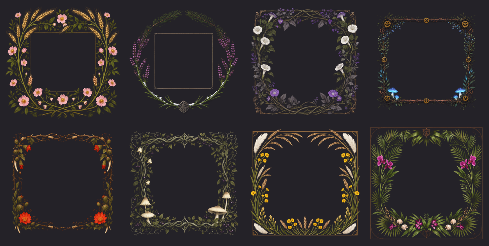
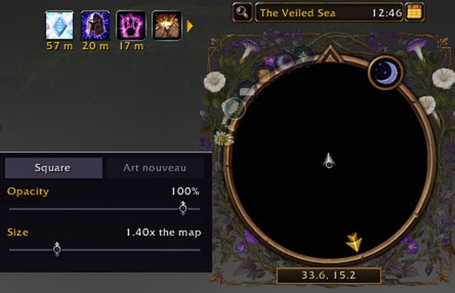
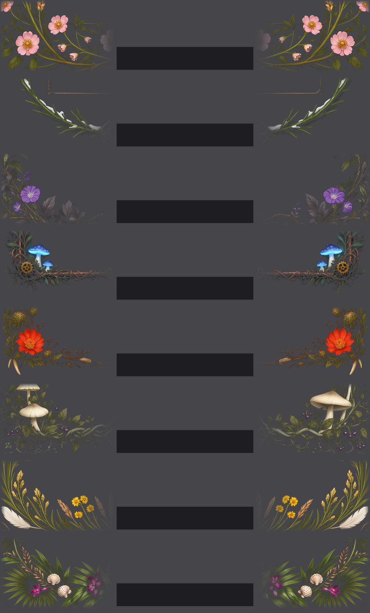
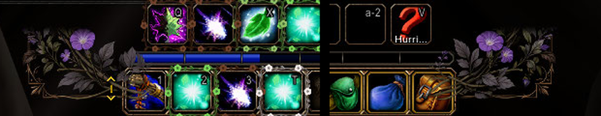
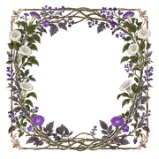

# Homeland









### Your homeland, not your faction: your race's own flowers round the minimap and at the ends of your action bar.

## What you get

- **A frame for your minimap**, grown from your race's plants: moonflowers for night elves, dog roses for humans,
  heather for dwarves, blue mushrooms for gnomes, cactus flowers for orcs, nightshade for the undead, prairie
  wildflowers for tauren, orchids for trolls. Painted and square, or drawn in art nouveau curves.
- **Bar end caps to match**, in place of the gryphons or wyverns, with the heavy end against the bar or out at the
  screen edge, and draggable if your bar sits somewhere else.
- **Coordinates you can read at a glance**, set into the bottom of the frame like the engraved plate on a photo frame:
  black, rimmed in your race's colour, the numbers always crisp white.
- **One panel, two sliders.** Click the minimap button: Square or Art nouveau, Opacity from 0 to 100%, and Size. Fade
  the art right back for a quiet screen and the coordinates stay sharp.
- **Light to run.** No protected frames, so nothing breaks in combat, and addons that fade the action bar don't dim it.

## Why

The default interface tells you which faction you're on, and nothing about where you're from. Every Alliance player
has the same gryphons, every Horde player the same wyverns, and the minimap is a bare ring with the coordinates
floating over whatever is behind it. Homeland gives each of the eight original races its own home on screen: the
moonflowers of Teldrassil, the meadows of Elwynn, the heather of Dun Morogh, the mushrooms of Gnomeregan, the thorns of
Durotar, the nightshade of Tirisfal, the grass of Mulgore and the orchids of the Echo Isles.

## Download

1. Download `Homeland-vX.Y.Z.zip` from the [latest release](https://github.com/rainbowpusheenthe3rd/homeland/releases/latest).
2. Unzip the `Homeland` folder into `World of Warcraft\_forever_\Interface\AddOns`.
3. Log in. Your race is picked up on its own; click the minimap button to choose a frame and set its opacity and size.

Commands: `/homeland hug | corner` (where the caps' heavy end sits), `/homeland move` (drag the caps; again to
finish), `/homeland reset`, `/homeland map square | nouveau | on | off | <size>`, `/homeland off | on`.

<details>
<summary>Art and development</summary>

The bar end caps and the square minimap art are cut from AI-generated race concepts (MOSS-Image, Apache-2.0) by
`tools/homeland_caps.py`; the art nouveau frames are drawn in code by `tools/homeland_nouveau.py`. Stillwater uses the
same race palette; Homeland needs nothing else.

For development, link the game's folder to this repo (a directory junction, run once):

```powershell
New-Item -ItemType Junction -Path "<WoW folder>\_forever_\Interface\AddOns\Homeland" -Target "<this repo>"
```

`tests/` holds its smoke tests (`uv run --with lupa python tests/<file>.py`).

</details>

<p align="center"></p>
