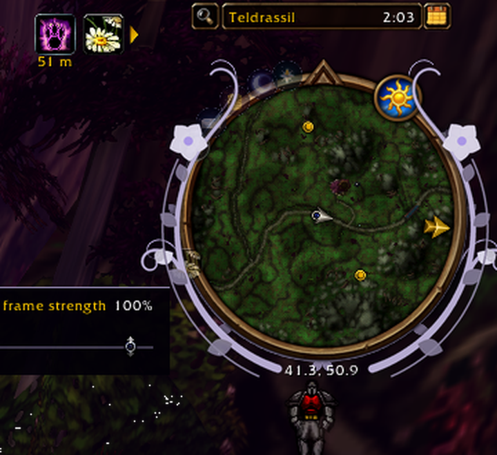
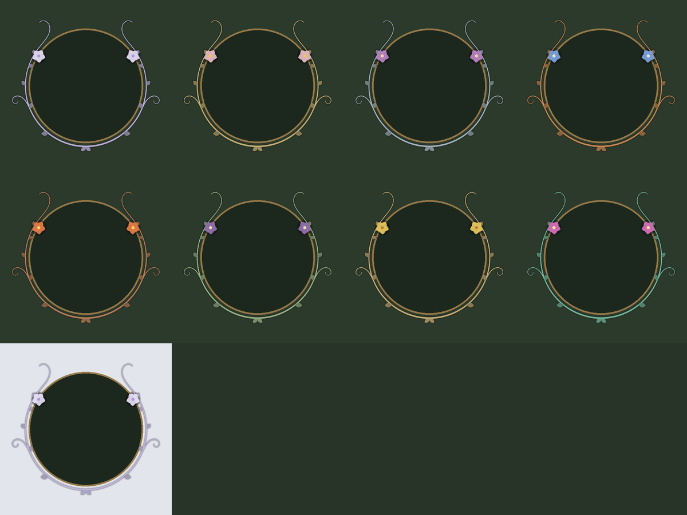

# Homeland

Trial: your race's homeland plants in place of the gryphons or wyverns at the ends of the main action bar. /homeland off|on

## Install

From a release zip: unzip the `Homeland` folder into `World of Warcraft\_forever_\Interface\AddOns`.

For development, link the game's folder to this repo (a directory junction, run once):

```powershell
New-Item -ItemType Junction -Path "<WoW folder>\_forever_\Interface\AddOns\Homeland" -Target "<this repo>"
```

`tools/` holds the generators for its art, `tests/` its smoke tests (`uv run --with lupa python tests/<file>.py`).

## Art

The bar end caps and the square minimap art are cut from AI-generated race concepts (MOSS-Image, Apache-2.0),
by `tools/homeland_caps.py`. The art nouveau minimap frames are drawn in code (`tools/homeland_nouveau.py`).





## Talks to

Nothing; works alone. Stillwater uses the same race palette.
